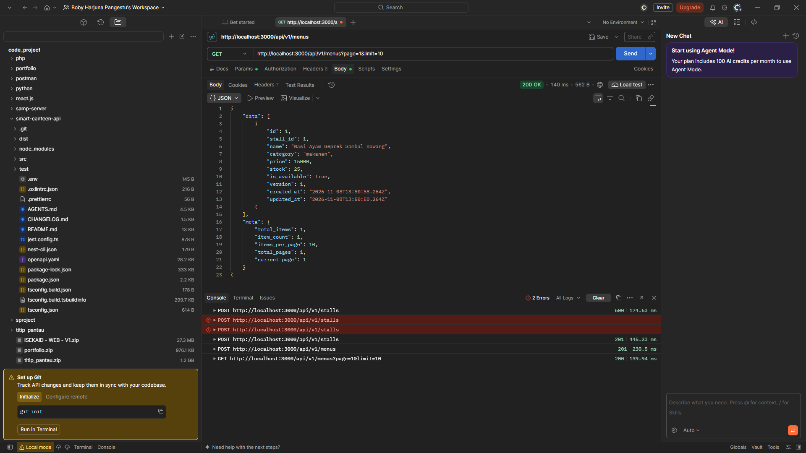
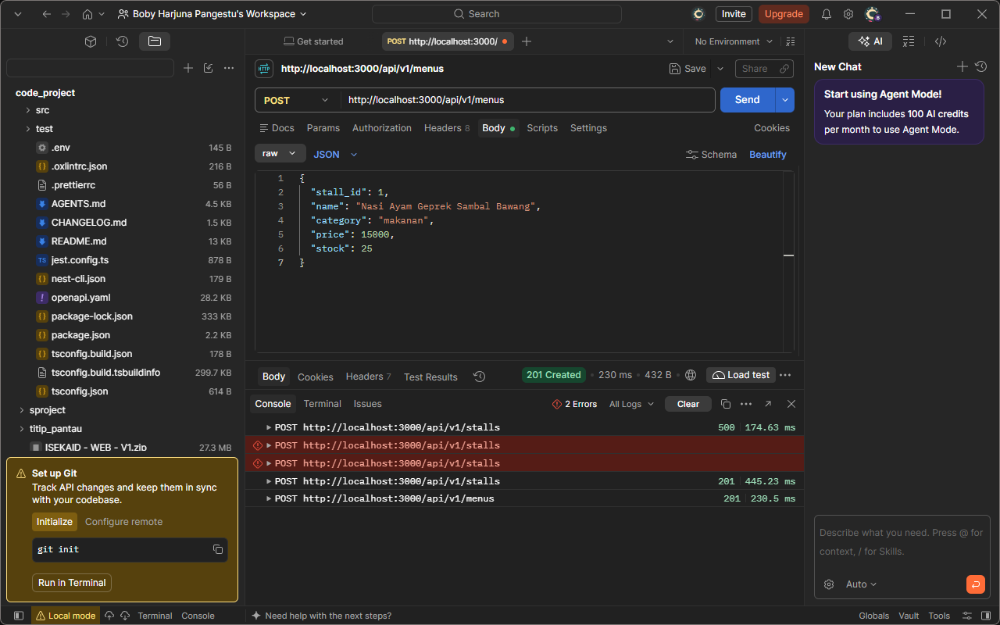
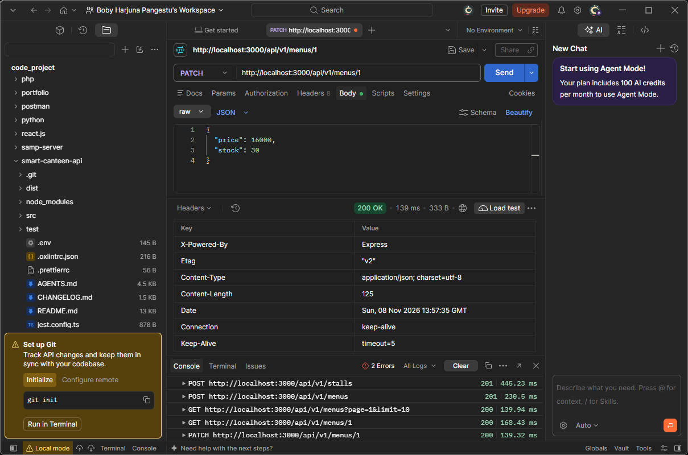
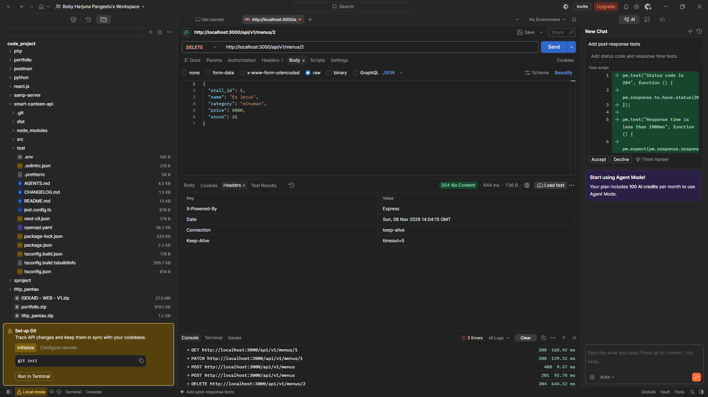
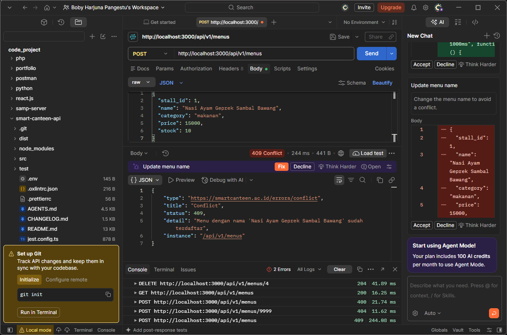
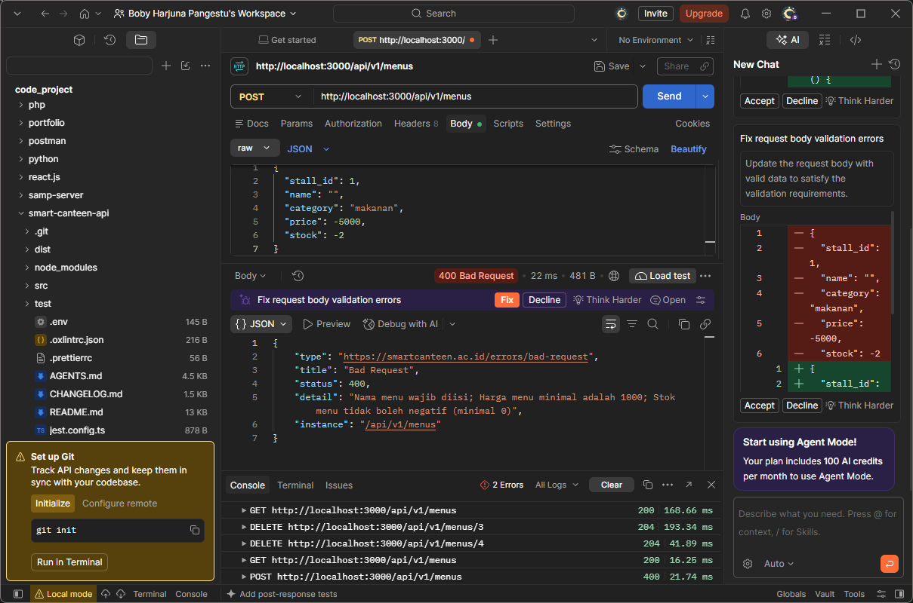
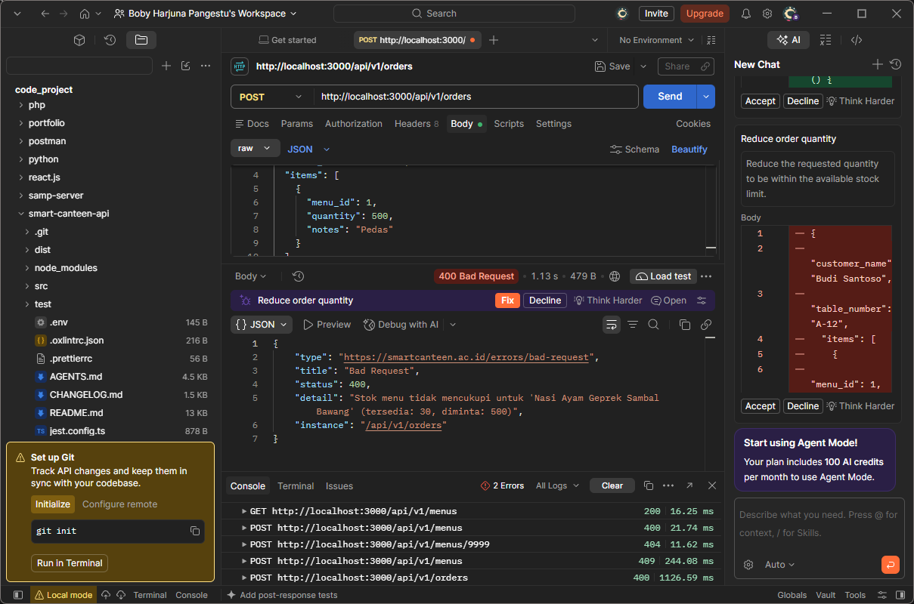
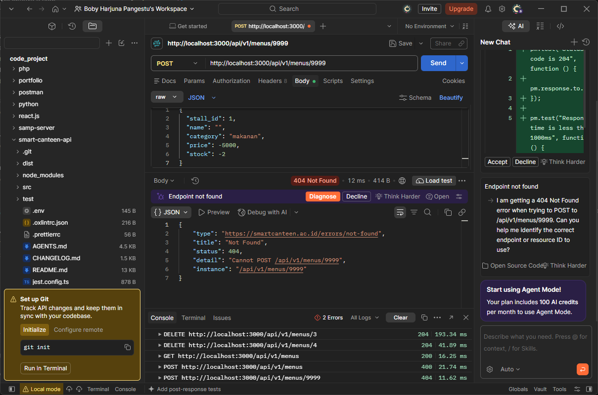

# Smart Canteen REST API

Aplikasi Backend REST API untuk **Sistem Pemesanan Kantin Kampus (Smart Canteen)** yang dibangun menggunakan **NestJS (TypeScript)** dan **PostgreSQL (TypeORM)**. Proyek ini mengimplementasikan spesifikasi kontrak API dari Pertemuan 1–4 serta memenuhi seluruh kebutuhan **Pertemuan 5, 6, dan 7**:

1. **Konfigurasi Global & URI Versioning (`/api/v1/...`)** beserta `ValidationPipe` ketat dan **RFC 7807 / RFC 9457 Problem Details Exception Filter**.
2. **Integrasi PostgreSQL, TypeORM Entities, Database Constraints (`PRIMARY KEY`, `FOREIGN KEY`, `UNIQUE`, `NOT NULL`, `CHECK`, `@VersionColumn`), dan Database Migration**.
3. **Arsitektur Modular & Dependency Injection** (`Controller`, `Service`, `Repository`, `DTO`, `Entity`, `Module`) untuk 3 resource utama (`Stalls`, `Menus`, `Orders`).
4. **Fitur REST API Lanjutan**:
   - **Filtering, Offset Pagination (`data` & `meta`), dan Tie-breaker Sorting (`id:asc`)** pada `/api/v1/menus`.
   - **ETag & Optimistic Locking (`If-Match` -> `412 Precondition Failed`)** pada pembaruan menu.
   - **Database Transaction Atomik (`QueryRunner`: `startTransaction`, `commitTransaction`, `rollbackTransaction`)** pada `/api/v1/orders`.
5. **Dokumentasi OpenAPI 3.0 & Swagger UI (`/api/docs`)** dengan auto-export spesifikasi ke [`openapi.yaml`](./openapi.yaml) serta **Automated Unit & E2E Testing (Jest + Supertest)**.

---

## Struktur Folder Modular

```text
smart-canteen-api/
├── src/
│   ├── common/
│   │   ├── dto/
│   │   │   └── problem-details.dto.ts        # Schema OpenAPI untuk RFC 7807 / RFC 9457
│   │   ├── filters/
│   │   │   └── problem-details.filter.ts     # Custom Global Exception Filter (400, 404, 409, 412, 500)
│   │   └── setup-app.ts                      # Konfigurasi global prefix, versioning, pipe, filter & Swagger
│   ├── database/
│   │   ├── migrations/
│   │   │   └── 1730000000000-InitialSmartCanteenSchema.ts # File Migration tabel stalls, menus, orders, order_items
│   │   └── data-source.ts                    # Konfigurasi TypeORM DataSource untuk CLI Migration
│   ├── stalls/
│   │   ├── dto/                              # CreateStallDto, UpdateStallDto, FilterStallDto
│   │   ├── entities/
│   │   │   └── stall.entity.ts               # Entity Stall (tabel stalls)
│   │   ├── stalls.controller.ts              # Endpoint /api/v1/stalls
│   │   ├── stalls.service.ts                 # Business logic & validasi konflik nama stan
│   │   ├── stalls.repository.ts              # Abstraksi akses database TypeORM Stall
│   │   └── stalls.module.ts
│   ├── menus/
│   │   ├── dto/                              # CreateMenuDto, UpdateMenuDto, QueryMenuDto, PaginatedMenuResponseDto
│   │   ├── entities/
│   │   │   └── menu.entity.ts                # Entity Menu (tabel menus) + @VersionColumn()
│   │   ├── menus.controller.ts               # Endpoint /api/v1/menus + Header ETag & If-Match
│   │   ├── menus.service.ts                  # Business logic, ETag generator & validasi If-Match (412)
│   │   ├── menus.service.spec.ts             # Unit Test MenusService
│   │   ├── menus.repository.ts               # QueryBuilder Filtering, Offset Pagination & Tie-breaker Sorting
│   │   └── menus.module.ts
│   ├── orders/
│   │   ├── dto/                              # CreateOrderDto, CreateOrderItemDto, UpdateOrderStatusDto
│   │   ├── entities/
│   │   │   ├── order.entity.ts               # Entity Order (tabel orders)
│   │   │   └── order-item.entity.ts          # Entity OrderItem (tabel order_items)
│   │   ├── orders.controller.ts              # Endpoint /api/v1/orders
│   │   ├── orders.service.ts                 # Transaksi database atomik via QueryRunner
│   │   ├── orders.service.spec.ts            # Unit Test OrdersService (Commit & Rollback)
│   │   ├── orders.repository.ts              # Query relasi Order & OrderItem
│   │   └── orders.module.ts
│   ├── app.module.ts                         # Root Module (ConfigModule + TypeOrmModule)
│   └── main.ts                               # Entrypoint aplikasi
├── test/
│   ├── app.e2e-spec.ts                       # Automated E2E Test (4 Skenario Utama Kontrak API)
│   └── jest-e2e.json
├── openapi.yaml                              # Spesifikasi OpenAPI 3.0 yang di-export otomatis
├── .env.example                              # Contoh konfigurasi environment variabel
└── package.json
```

---

## Cara Setup PostgreSQL & Menjalankan Migration

### 1. Instalasi Dependensi
```bash
npm install
```

### 2. Konfigurasi Environment (`.env`)
Salin file `.env.example` menjadi `.env` dan sesuaikan kredensial PostgreSQL Anda:
```bash
cp .env.example .env
```
Contoh isi `.env`:
```env
PORT=3000
DB_TYPE=postgres
DB_HOST=localhost
DB_PORT=5432
DB_USERNAME=postgres
DB_PASSWORD=your_db_password_here
DB_NAME=smart_canteen_db
DB_SYNCHRONIZE=false
```

### 3. Buat Database PostgreSQL & Jalankan Migration
Buat database `smart_canteen_db` di PostgreSQL, lalu jalankan migration TypeORM:
```bash
# Membuat database di PostgreSQL
psql -U postgres -c "CREATE DATABASE smart_canteen_db;"

# Menjalankan migration untuk membuat tabel stalls, menus, orders, dan order_items
npm run migration:run

# (Opsional) Rollback migration terakhir
npm run migration:revert
```

### 4. Menjalankan Aplikasi & Mengakses Swagger UI
```bash
# Mode development
npm run start:dev
```
- **Base URL API**: `http://localhost:3000/api/v1`
- **Swagger UI**: `http://localhost:3000/api/docs`
- **File OpenAPI YAML**: otomatis tersedia di [`./openapi.yaml`](./openapi.yaml)

---

## Daftar Endpoint REST API

### 1. Resource `Stalls` (`/api/v1/stalls`)
| Method | URI | Deskripsi | Status Code |
| :--- | :--- | :--- | :--- |
| `GET` | `/api/v1/stalls` | Mengambil daftar stan kantin (mendukung query `?is_open=true\|false`) | `200 OK`, `400 Bad Request` |
| `POST` | `/api/v1/stalls` | Mendaftarkan stan kantin baru (`name` wajib unik) | `201 Created`, `400 Bad Request`, `409 Conflict` |
| `GET` | `/api/v1/stalls/:id` | Mengambil detail stan berdasarkan ID | `200 OK`, `404 Not Found` |
| `PUT` | `/api/v1/stalls/:id` | Memperbarui data stan kantin | `200 OK`, `400 Bad Request`, `404 Not Found`, `409 Conflict` |
| `DELETE` | `/api/v1/stalls/:id` | Menghapus stan kantin | `204 No Content`, `404 Not Found` |

### 2. Resource `Menus` (`/api/v1/menus`)
| Method | URI | Deskripsi | Status Code |
| :--- | :--- | :--- | :--- |
| `GET` | `/api/v1/menus` | Mengambil daftar menu dengan **Filtering** (`category`, `stall_id`, `min_price`, `max_price`), **Offset Pagination** (`page`, `limit` -> `{ data, meta }`), & **Tie-breaker Sorting** (`sort`, default `created_at:desc,id:asc`) | `200 OK`, `400 Bad Request` |
| `GET` | `/api/v1/menus/:id` | Mengambil detail menu & menyertakan response header `ETag` (contoh: `"v1"`) | `200 OK`, `404 Not Found` |
### Bukti Pengujian Postman

| `POST` | `/api/v1/menus` | Menambahkan menu baru (`price >= 1000`, `stock >= 0`, `name` unik) | `201 Created`, `400 Bad Request`, `404 Not Found`, `409 Conflict` |
### Bukti Pengujian Postman

| `PUT` | `/api/v1/menus/:id` | Memperbarui seluruh data menu (mendukung Optimistic Locking via header `If-Match`) | `200 OK`, `400`, `404`, `409`, `412 Precondition Failed` |
| `PATCH` | `/api/v1/menus/:id` | Memperbarui sebagian data menu (mendukung Optimistic Locking via header `If-Match`) | `200 OK`, `400`, `404`, `409`, `412 Precondition Failed` |
### Bukti Pengujian Postman

| `DELETE` | `/api/v1/menus/:id` | Menghapus menu berdasarkan ID | `204 No Content`, `404 Not Found` |
### Bukti Pengujian Postman


### 3. Resource `Orders` (`/api/v1/orders`)
| Method | URI | Deskripsi | Status Code |
| :--- | :--- | :--- | :--- |
| `POST` | `/api/v1/orders` | Membuat pesanan baru dalam **Database Transaction (`QueryRunner`)**: cek keberadaan `menu_id`, cek kecukupan stok, kurangi `menu.stock`, hitung `subtotal` & `total_price`, commit (atau rollback penuh jika gagal) | `201 Created`, `400 Bad Request`, `404 Not Found` |
| `GET` | `/api/v1/orders` | Mengambil seluruh daftar pesanan beserta `items` | `200 OK` |
| `GET` | `/api/v1/orders/:id` | Mengambil detail pesanan berdasarkan ID | `200 OK`, `404 Not Found` |
| `PATCH` | `/api/v1/orders/:id/status` | Memperbarui `order_status` (`pending` \| `processing` \| `completed` \| `cancelled`) | `200 OK`, `400 Bad Request`, `404 Not Found` |

---

## Format Standar Error (RFC 7807 / RFC 9457 Problem Details)

Seluruh error (`400`, `404`, `409`, `412`, `500`) diformat secara konsisten oleh `ProblemDetailsExceptionFilter` dengan header `Content-Type: application/problem+json`:

```json
{
  "type": "https://smartcanteen.ac.id/errors/conflict",
  "title": "Conflict",
  "status": 409,
  "detail": "Menu dengan nama 'Nasi Goreng Kampus Spesial' sudah terdaftar",
  "instance": "/api/v1/menus"
}
```
### Bukti Postman


---

## Matriks Skenario Pengujian Otomatis (Unit & E2E Test)

Jalankan pengujian otomatis melalui command line:
```bash
# Menjalankan Unit Test
npm run test

# Menjalankan End-to-End (E2E) Test (Supertest + In-Memory SQL)
npm run test:e2e
```

| ID Uji | Kategori Skenario | Endpoint / Modul | Kondisi Input | Ekspektasi Output | Status |
| :--- | :--- | :--- | :--- | :--- | :--- |
| **TC-01** | **1. Skenario Berhasil** | `POST /api/v1/stalls` & `POST /api/v1/menus` | Data stan & menu valid (`price >= 1000`, `stock >= 0`) | `201 Created`, objek tersimpan di DB dengan `version = 1` dan header `ETag: "v1"` | PASS |
| **TC-02** | **1. Skenario Berhasil** | `GET /api/v1/menus` | Query filter `stall_id`, `min_price`, `max_price`, `page=1&limit=10&sort=price:asc,id:asc` | `200 OK`, mengembalikan objek `{ data, meta }` dengan urutan stabil | PASS |
| **TC-03** | **1. Skenario Berhasil** | `PATCH /api/v1/menus/:id` | Header `If-Match: "v1"` sesuai ETag saat ini | `200 OK`, harga ter-update, `version` naik menjadi `2`, header `ETag: "v2"` | PASS |
| **TC-04** | **1. Skenario Berhasil** | `POST /api/v1/orders` | `items` valid dan stok mencukupi | `201 Created`, `total_price` akurat, stok menu terpotong dan transaksi di-*commit* | PASS |
| **TC-05** | **2. Validasi Gagal (400)** | `POST /api/v1/menus` | `price: -5000` (di bawah batas minimum Rp 1.000) | `400 Bad Request` dengan format Problem Details (`https://smartcanteen.ac.id/errors/bad-request`) | PASS |
### Bukti Pengujian Postman

| **TC-06** | **2. Validasi Gagal & Rollback (400)** | `POST /api/v1/orders` | Item ke-1 stok cukup (`qty: 3`), item ke-2 stok kurang (`qty: 99`) | `400 Bad Request` ("Stok menu tidak mencukupi") & **Rollback Transaksi** menjaga stok item ke-1 tetap utuh (`8`) | PASS |
### Bukti Pengujian Postman

| **TC-07** | **3. Data Tidak Ditemukan (404)** | `GET /api/v1/menus/99999` & `GET /api/v1/orders/99999` | Parameter ID tidak terdaftar di database | `404 Not Found` dengan format Problem Details (`https://smartcanteen.ac.id/errors/not-found`) | PASS |
### Bukti Pengujian Postman

| **TC-08** | **3. Data Tidak Ditemukan & Rollback (404)** | `POST /api/v1/orders` | Array `items` memuat `menu_id: 88888` yang tidak terdaftar | `404 Not Found` & **Rollback Transaksi** menjaga stok item lain tidak terpotong | PASS |
| **TC-09** | **4. Konflik Data (409)** | `POST /api/v1/menus` & `POST /api/v1/stalls` | Mengirim `name` menu atau stan yang sudah pernah didaftarkan | `409 Conflict` dengan format Problem Details (`https://smartcanteen.ac.id/errors/conflict`) | PASS |
### Bukti Postman

| **TC-10** | **4. Konflik Optimistic Locking (412)** | `PUT /api/v1/menus/:id` | Mengirim header `If-Match: "v1"` padahal versi menu di server sudah meningkat | `412 Precondition Failed` dengan format Problem Details (`https://smartcanteen.ac.id/errors/precondition-failed`) | PASS |

---

## Laporan Singkat Evaluasi Hasil Pengujian

Berdasarkan hasil eksekusi **Unit Test** (`menus.service.spec.ts` dan `orders.service.spec.ts`) serta **End-to-End (E2E) Test** (`test/app.e2e-spec.ts`), seluruh endpoint pada aplikasi **Smart Canteen REST API** telah memenuhi spesifikasi kontrak API Pertemuan 1 hingga Pertemuan 7:

1. **Kepatuhan Kontrak & Standarisasi Error**: Seluruh endpoint berjalan di bawah prefix `/api/v1` dan setiap skenario kesalahan (`400`, `404`, `409`, `412`) menghasilkan struktur JSON sesuai standar **RFC 7807 / RFC 9457 Problem Details**.
2. **Integritas Transaksi Database (ACID)**: Pengujian multi-item pada `POST /api/v1/orders` membuktikan bahwa ketika item kedua gagal karena stok tidak mencukupi (`400`) atau `menu_id` tidak ditemukan (`404`), `QueryRunner.rollbackTransaction()` membatalkan pemotongan stok pada item pertama sehingga tidak terjadi inkonsistensi stok (*partial update*).
3. **Konkurensi & Optimistic Locking**: Penggunaan `@VersionColumn()` yang dikombinasikan dengan response header `ETag` dan validasi request header `If-Match` berhasil mencegah *lost update* dengan mengembalikan status `412 Precondition Failed` saat versi data sudah usang.
4. **Kesiapan Dokumentasi OpenAPI**: Seluruh skema request/response dan kode status telah terdokumentasi di Swagger UI (`/api/docs`) serta ter-export otomatis ke dalam berkas [`openapi.yaml`](./openapi.yaml). Aplikasi dinyatakan **siap untuk evaluasi UTS**.
